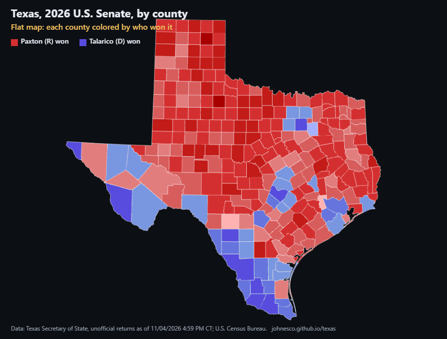

# Why Texas looks red

An interactive map of all 18 statewide races in the Texas general election of Nov. 3, 2026, from U.S. Senate and
Governor to the state's high courts. It starts as the familiar flat county map, then raises each county into a column
whose height is the number of votes cast there. The point is to show why a map that is mostly red can still belong to
a statewide Democratic win. Each race has its own link, e.g. `?race=governor`.

**Live:** https://johnesco.github.io/texas/



## All races (computed from the data file)

| Race | Democrat | Republican | Statewide | Counties won (R / D) | Land in R-won counties |
|---|---|---|---|---|---|
| [U.S. Senate](https://johnesco.github.io/texas/?race=u-s-senate) | James Talarico | Ken Paxton | D 55.1% – R 43.0% | 214 / 40 | 78% |
| [Governor](https://johnesco.github.io/texas/?race=governor) | Gina Hinojosa | Greg Abbott (inc.) | D 52.8% – R 45.7% | 217 / 37 | 79% |
| [Lieutenant Governor](https://johnesco.github.io/texas/?race=lieutenant-governor) | Vikki Goodwin | Dan Patrick (inc.) | D 51.7% – R 45.6% | 218 / 36 | 80% |
| [Attorney General](https://johnesco.github.io/texas/?race=attorney-general) | Nathan Johnson | Mayes Middleton | D 52.4% – R 45.9% | 218 / 36 | 80% |
| [Comptroller of Public Accounts](https://johnesco.github.io/texas/?race=comptroller) | Sarah Eckhardt | Don Huffines | D 51.3% – R 46.2% | 220 / 34 | 80% |
| [Commissioner of the General Land Office](https://johnesco.github.io/texas/?race=land-commissioner) | Benjamin Flores | Dawn Buckingham (inc.) | D 51.4% – R 47.0% | 219 / 35 | 79% |
| [Commissioner of Agriculture](https://johnesco.github.io/texas/?race=agriculture-commissioner) | Clayton Tucker | Nate Sheets | D 51.3% – R 46.6% | 219 / 35 | 79% |
| [Railroad Commissioner](https://johnesco.github.io/texas/?race=railroad-commissioner) | Jon Rosenthal | Bo French | D 52.5% – R 45.5% | 218 / 36 | 80% |
| [Supreme Court, Chief Justice](https://johnesco.github.io/texas/?race=supreme-court-chief-justice) | Maggie Ellis | Jimmy Blacklock (inc.) | D 52.4% – R 47.6% | 219 / 35 | 80% |
| [Supreme Court, Place 2 (unexpired term)](https://johnesco.github.io/texas/?race=supreme-court-place-2) | Chari Kelly | James P. Sullivan (inc.) | D 52.3% – R 47.7% | 220 / 34 | 80% |
| [Supreme Court, Place 7](https://johnesco.github.io/texas/?race=supreme-court-place-7) | Kristen Hawkins | Kyle Hawkins (inc.) | D 52.8% – R 47.2% | 219 / 35 | 80% |
| [Supreme Court, Place 8](https://johnesco.github.io/texas/?race=supreme-court-place-8) | Gisela D. Triana | Brett Busby (inc.) | D 52.0% – R 48.0% | 220 / 34 | 80% |
| [Court of Criminal Appeals, Place 3](https://johnesco.github.io/texas/?race=criminal-appeals-place-3) | Okey Anyiam | Thomas Smith | D 50.0% – R 47.6% | 220 / 34 | 80% |
| [Court of Criminal Appeals, Place 4](https://johnesco.github.io/texas/?race=criminal-appeals-place-4) | Audra Riley | Kevin Patrick Yeary (inc.) | D 51.7% – R 48.3% | 220 / 34 | 80% |
| [Court of Criminal Appeals, Place 9](https://johnesco.github.io/texas/?race=criminal-appeals-place-9) | Holly Taylor | John Messinger | D 52.3% – R 47.7% | 220 / 34 | 80% |
| [15th Court of Appeals, Chief Justice](https://johnesco.github.io/texas/?race=fifteenth-court-chief-justice) | Jerry Zimmerer | Scott Brister (inc.) | D 51.8% – R 48.2% | 220 / 34 | 80% |
| [15th Court of Appeals, Place 2](https://johnesco.github.io/texas/?race=fifteenth-court-place-2) | Tom Baker | Scott K. Field (inc.) | D 52.0% – R 48.0% | 220 / 34 | 80% |
| [15th Court of Appeals, Place 3](https://johnesco.github.io/texas/?race=fifteenth-court-place-3) | Marc M. Meyer | April Farris (inc.) | D 51.5% – R 48.5% | 220 / 34 | 80% |

In every race the Democrat won statewide while the Republican won most counties and most of the land.

## Data and method

- **Results:** Texas Secretary of State, Election Night Returns, 2026 November General Election (election id 53815),
  county-level results for every statewide race, as of 11/04/2026 04:59 PM Central, retrieved 2026-11-04. All precincts are
  reporting in all 254 counties. These results are **unofficial** until the state canvass.
  - Results site: https://goelect.txelections.civixapps.com/ivis-enr-ui/races
  - Data feed: https://goelect.txelections.civixapps.com/api-ivis-system/api/s3/enr/election/countyInfo/53815
  - Statewide page used as a cross-check: https://electionresults.sos.state.tx.us/results.html
- **Land area and FIPS codes:** U.S. Census Bureau, 2024 Gazetteer Files, counties (`ALAND_SQMI`, water excluded).
  https://www.census.gov/geographies/reference-files/time-series/geo/gazetteer-files.html
- **County shapes:** U.S. Census Bureau cartographic boundary files, 2017, via
  [us-atlas](https://github.com/topojson/us-atlas) v3.0.1 (`counties-10m.json`).
- **Column height** is proportional to the total votes cast in the selected race, counting every candidate including
  write-ins, on a linear scale (one scale shared by all races). Counties with very few votes get a thin minimum height so they stay visible.
- **Color** is the county winner's share of all votes cast there, in 10-point bands.

The raw snapshots are in [`data/raw/`](data/raw). [`scripts/build_data.py`](scripts/build_data.py) rebuilds
[`data/results-2026.json`](data/results-2026.json) from them. That file holds all 18 races that were on the ballot in
all 254 counties, and the page offers every one of them. The script stops with an
error unless all of these hold, for every race:

- the race is reported in each of the 254 counties, with all precincts reporting
- each county's candidate votes add up to its race total
- every county matches a Census FIPS code
- every candidate's county votes add up exactly to that candidate's total on the Secretary of State's statewide page

Candidate names are listed in capitals by the Secretary of State; the script converts them to normal capitalization
for display (e.g. McCormick, and DiBianca as spelled by [Ballotpedia](https://ballotpedia.org/Arthur_DiBianca)).

```bash
python scripts/build_data.py
```

## Running locally

The page loads its data with `fetch`, so it has to be served over HTTP:

```bash
python -m http.server 8765
```

Then open http://localhost:8765.

Built with [three.js](https://threejs.org) r160, [d3-geo](https://github.com/d3/d3-geo) 3.1.1 and
[topojson-client](https://github.com/topojson/topojson-client) 3.1.0.
